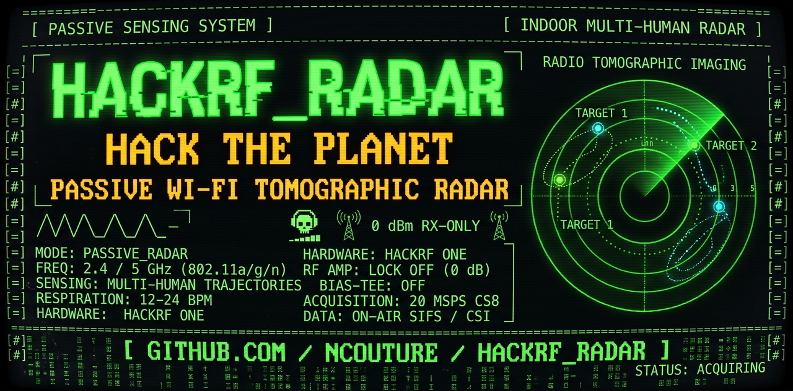

# HackRF passive Wi-Fi tomographic radar




[](https://www.python.org/)
[](LICENSE)
[](https://github.com/ncouture/hackrf_radar)

`hackrf-radar` is a passive (`0 dBm` receive-only) indoor multi-human sensing system built around a single HackRF One software-defined radio. It captures ambient IEEE 802.11a/g/n traffic across 2.4 GHz and 5 GHz channels without associating to any network, transmitting any RF energy, or decrypting protected payloads. From cleartext `L-STF`/`L-LTF` preambles and MAC headers, the pipeline estimates 2D human presence maps, walking trajectories, and stationary respiratory rates (`12` to `24 BPM`).

## System architecture

The codebase is organized into four layers under `hackrf_radar/`:

* `hackrf_radar/capture/` (`packet_event.py`, `soapy_source.py`, `gr_wifi_bridge.py`, `simulator.py`) manages 20 MSPS 8-bit I/Q acquisition, 2.4/5 GHz channel hopping, cleartext 802.11 OFDM preamble synchronization, 52-subcarrier `L-LTF` channel state information (`CSI`) extraction, MAC frame attribution, and synthetic physics simulation.
* `hackrf_radar/tomography/` (`geometry.py`, `features.py`, `solver.py`) computes First Fresnel Zone elliptical sensitivity weights ($\Delta_{ij} < \lambda/2$), extracts link-level RSSI perturbation, sanitized CSI turbulence, and respiratory power spectral density (`0.1` to `25 Hz`), solves non-negative total-variation regularized Radio Tomographic Imaging (`fista_tv`, `nnls`, `sart`), and runs multi-target Kalman tracking.
* `hackrf_radar/web/` (`serializer.py`, `server.py`, `static/`) provides a Python standard-library HTTP and Server-Sent Events (`SSE`) server with a browser UI for live 2D tomography heatmaps, 52-subcarrier `L-LTF` CSI inspection, solver convergence, vital-sign PSD plots, and runtime solver controls.
* `hackrf_radar/config.py`, `hackrf_radar/plotter.py`, `hackrf_radar/cli.py`, and `run_radar.py` provide passive front-end safety locks, JSON room configuration, a 20+ FPS dashboard (`pyqtgraph`, blitted `matplotlib`, `rich` ANSI Truecolor TUI, and `web`), JSONL session recording/replay, and PNG snapshot export.

Because a single HackRF receiver forms a radial fan of chords toward room transmitters, the capture layer also tracks Short Interframe Space (`SIFS`, `10 us` at 2.4 GHz and `16 us` at 5 GHz) control exchanges (`RTS`/`CTS`, `Data`/`ACK`, `BlockAck`). Attributing 1-address `CTS` and `ACK` frames to the preceding frame's receiver address adds cross-room peer chords that suppress single-receiver fan intersection ghosts during multi-human inversion.

## Hardware setup and gain staging

All live capture paths enforce `0 dBm` passive reception in both configuration (`RxSettings` in `hackrf_radar/config.py`) and driver initialization (`hackrf_radar/capture/soapy_source.py`):

* Transmit APIs (`hackrf_start_tx`, `soapy_hackrf_sink`, `hackrf_transfer -t`) are absent and forbidden.
* The HackRF One MGA-81563 `+14 dB` RF front-end amplifier is locked off (`amp_enable = False`, `-a 0`). Enabling the RF amplifier near indoor Wi-Fi access points saturates the MAX5864 8-bit ADC and creates intermodulation artifacts across subcarriers.
* Antenna port DC bias-tee power is locked off (`bias_tee_enable = False`).
* Manual gain staging defaults to `lna_db = 24` (MAX2837 IF LNA, `0..40 dB` in `8 dB` steps) and `vga_db = 20` (baseband VGA, `0..62 dB` in `2 dB` steps) at `20 MSPS`.
* Watch the `ADC Clip` indicator in the passive Wi-Fi HUD during live operation. If the fraction of int8 samples with `|I| >= 120` or `|Q| >= 120` rises above `1%`, lower `--lna-db` by one `8 dB` step (to `16`) or reduce `--vga-db` to `14`. If packet SNR is low in a large room, raise `--vga-db` in `4 dB` increments while keeping `AMP` off.
* Place the HackRF One with a 2.4/5 GHz dipole antenna near one wall (for example `(3.0, 0.35)` m on the south wall of a `6.0 m x 5.0 m` room) with vertical polarization matching nearby access points. After each channel hop (`Ch 1: 2412 MHz`, `Ch 6: 2437 MHz`, `Ch 11: 2462 MHz`, plus optional 5 GHz UNII channels `36..165`), the capture loop discards `2` to `5 ms` of post-tune PLL settling samples and isolates per-channel state.

## GNU Radio bridge and native OFDM fallback

`hackrf_radar/capture/gr_wifi_bridge.py` and `grc/hackrf_wifi_passive_radar.grc` support multiple live and offline ingestion paths so capture works across varied host installations:

* When `SoapyHackRF` is installed, `HackRFPacketCapture(backend="auto")` streams 20 MSPS CS8 I/Q via `SoapySDR`. When `libHackRFSupport.so` is absent on the host, `"auto"` falls back automatically to `ctypes.CDLL("libhackrf.so.0")`, `gnuradio-osmosdr` (`osmosdr.source("hackrf=0")`), or `hackrf_transfer -r -`.
* When GNU Radio 3.10 and `gr-ieee802-11` are present, `grc/hackrf_wifi_passive_radar.grc` (or the programmatic flowgraph builder) decodes 802.11 frames and publishes PDUs over ZMQ (`--backend gr_zmq --zmq-endpoint tcp://127.0.0.1:5555`) or Radiotap PCAP (`--mode replay --input capture.pcap`), parsed with Python's `struct` module without requiring `scapy`.
* When binary `gr-ieee802-11` is not installed, `gr_wifi_bridge.py` executes a native NumPy/SciPy 20 MSPS 802.11a/g/n OFDM burst detector: Schmidl-Cox `L-STF` coarse timing and carrier frequency offset (`CFO`) estimation, `L-LTF` cross-correlation fine symbol alignment, 64-point FFT channel estimation across all 52 active subcarriers (`k in [-26..-1, +1..+26]`, tracking pilots `{-21, -7, +7, +21}`), linear sampling/packet-detection phase slope (`STO`/`PDD`) and random phase offset sanitization, 6 Mbps BPSK `L-SIG` and MAC header demodulation, and IEEE 802.11 CRC-32 (`FCS`) verification.
* From cleartext MAC headers, the bridge extracts `Beacon` 64-bit `TSF` timestamps to regress per-BSSID clock drift (`ppm`), tracks 12-bit `Sequence Control` gaps per transmitter, and counts `FCS` CRC drops as interference telemetry.

## Calibrating BSSID anchor positions

Tomographic spatial accuracy depends on knowing the `(x, y)` coordinates (in room meters, origin `(0, 0)` at the south-west corner) of the HackRF receiver and major ambient Wi-Fi transmitters.

1. Measure room width (`room_width`) and length (`room_height`) in meters and record the HackRF antenna position in `rx.rx_pos` inside a copy of `configs/example_room.json`.
2. Run a short live scan (`./run_radar.py --mode live --duration 5 --ui tui --record scan.jsonl`) to list active BSSIDs, channels, and frame rates in your space.
3. For fixed access points and stationary smart-home devices (plugs, speakers, printers, thermostats, cameras) whose locations you know, add entries under `"anchors"` in your JSON config with canonical uppercase MAC addresses (`"AA:BB:CC:00:00:01"`), `x`, `y`, and `channel`.
4. Keep `"auto_discovery": {"enabled": true}` in the JSON file so uncalibrated BSSIDs observed on air are placed automatically along the room perimeter using log-distance RSSI ranging and chord consistency.
5. For stationary rooms, pass `--calibrate-s 3.0` when nobody is inside the room so the engine records a clean empty-room baseline before tracking occupancy.

## Realtime web interface

`hackrf-radar` includes a browser interface served directly from Python's standard library (`http.server.ThreadingHTTPServer` and `text/event-stream`), requiring no extra web dependencies. Pass `--ui web` to run the browser dashboard standalone, or add `--web` alongside `tui`, `matplotlib`, or `pyqtgraph` to mirror frames to both displays.

The page displays the physical room voxel attenuation map with First Fresnel Zone ellipses, direct and SIFS peer chords, Kalman-tracked human positions and breathing rates, per-chord 52-subcarrier `L-LTF` CSI amplitude and sanitized phase, solver objective convergence (`J(x_k)`), `0.1` to `25 Hz` respiratory PSD, and live RF HUD metrics. Clicking any chord pins its Fresnel zone and subcarrier CSI profile; controls in the lower deck switch solvers (`fista_tv`, `nnls`, `sart`), tune regularization `lambda` and sliding window duration, trigger empty-room baseline calibration, pause rendering, or drag simulated targets in `--mode sim`.

HTTP endpoints bind to loopback (`127.0.0.1:8765`) by default and keep passive `0 dBm` RX-only locks enforced:

* `GET /` serves the Luminous light/dark web application with a strict Content Security Policy (no inline scripts).
* `GET /api/stream` streams realtime `config` and `frame` events over Server-Sent Events with drop-oldest backpressure so slow browser tabs do not stall capture.
* `GET /api/frame`, `GET /api/config`, and `GET /api/health` return the latest serialized `TomographyFrame`, room settings, and server health as JSON.
* `POST /api/control` accepts same-origin JSON updates for solver method, regularization, observation window, baseline calibration, and simulation target placement while rejecting any `amp_enable`, `bias_tee_enable`, or transmit keys.

## Command-line usage

Run the multi-human simulator (1, 2, or 3+ targets) with the realtime web interface, interactive GUI, or headless PNG snapshot export:

```bash
# Realtime browser tomography UI at http://127.0.0.1:8765/ (streams continuously until Ctrl+C)
python3 run_radar.py --mode sim --humans 2 --scenario walk_and_breathe --ui web

# Concurrent Rich TUI + realtime web UI on a custom port
python3 run_radar.py --mode sim --humans 2 --ui tui --web --web-port 8080

# 2-human walk + stationary breathing simulation (auto-selects pyqtgraph or matplotlib)
python3 run_radar.py --mode sim --humans 2 --scenario walk_and_breathe

# 3-human simulation saving a headless PNG snapshot
MPLBACKEND=Agg python3 run_radar.py --mode sim --humans 3 --duration 5.0 --no-gui --ui matplotlib --save-snapshot sim_3humans.png

# High-FPS PyQtGraph dashboard under system Python (interactive X11 or offscreen)
/usr/bin/python3 run_radar.py --mode sim --humans 2 --ui pyqtgraph --duration 5.0

# Rich ANSI Truecolor half-block TUI for SSH and terminal sessions
python3 run_radar.py --mode sim --humans 2 --ui tui --duration 5.0
```

Capture live ambient Wi-Fi passively from an attached HackRF One (`0 dBm` RX-only, `AMP` off) and record `PacketEvent` telemetry for offline replay:

```bash
# Live passive HackRF capture across channels 1, 6, and 11 with realtime browser UI
/usr/bin/python3 run_radar.py --mode live --config configs/example_room.json --channels 1 6 11 --lna-db 24 --vga-db 20 --ui web --record session.jsonl

# Replay a recorded JSONL session, Radiotap PCAP, or raw CS8/CF32 I/Q capture
python3 run_radar.py --mode replay --input session.jsonl --ui matplotlib --save-snapshot replay_check.png
```

## Dual-Python environment and testing

Every module runs under both standard Python 3.12 (`numpy`, `scipy`, `matplotlib`, `rich`) and system `/usr/bin/python3` 3.14 (which additionally provides `pyqtgraph`, `PyQt6`, `SoapySDR`, `gnuradio`, and `osmosdr`):

```bash
python3 -m pytest tests/
/usr/bin/python3 -m pytest tests/
```
